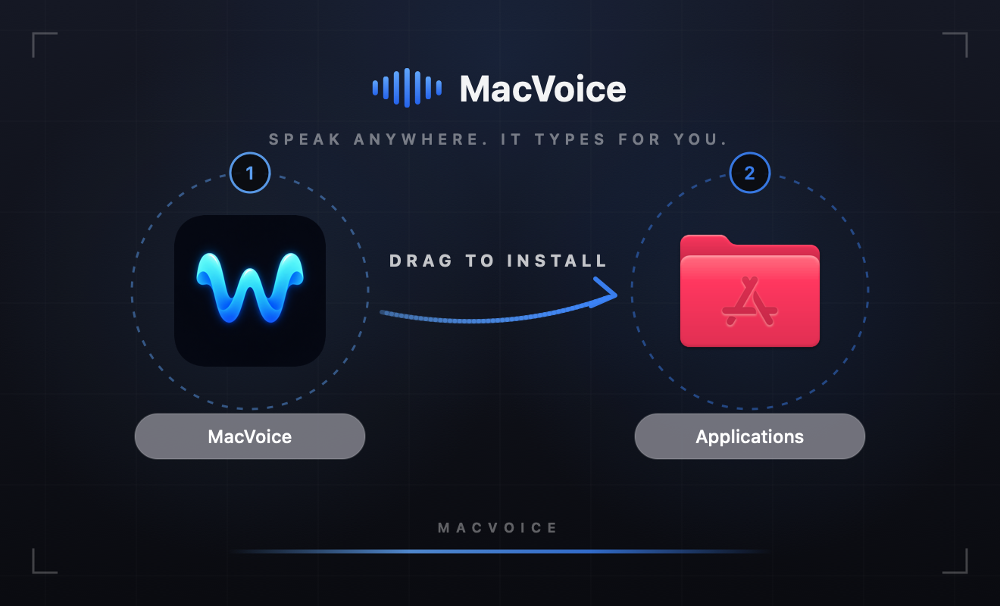

<div align="center">


# MacVoice

**Hold a key. Speak. Release. Your words are typed into any Mac app.**

Free, open-source voice dictation for macOS, powered by Whisper running entirely on your Mac.
No account, no subscription, no audio leaving your machine.

[**⬇️ Download for Mac (.dmg)**](https://github.com/winterzxzz/winter_voice/releases/latest)

[](https://github.com/winterzxzz/winter_voice/releases/latest)
[](https://github.com/winterzxzz/winter_voice/releases)
[](#-requirements)
[](#-requirements)
[](docs/DEVELOPMENT.md)
[](LICENSE)


**English · Tiếng Việt · 90+ languages**

</div>

> **MacVoice was previously called WinterVoice.** Same app and same data — only the name changed. If you already have WinterVoice installed, the in-app updater carries you over.

---

## Contents

- [What it does](#-what-it-does)
- [Install](#️-install)
- [How it works](#-how-it-works)
- [Features](#-features)
- [Voice prompts for AI agents](#-voice-prompts-for-ai-agents)
- [Privacy](#-privacy)
- [Requirements](#-requirements)
- [FAQ](#-faq)
- [Build from source](#️-build-from-source)

## 🎙️ What it does

MacVoice is a native macOS dictation app. Hold your push-to-talk key in Slack, Notes, a browser, a terminal or your IDE, say what you want to write, and let go — the text lands at your cursor.

Transcription runs on [whisper.cpp](https://github.com/ggml-org/whisper.cpp) **on your own Mac**. If you would rather use a server, point MacVoice at any **OpenAI-compatible transcription API** instead.

<p align="center"></p>

## ⬇️ Install

**[Download the latest `.dmg` from Releases →](https://github.com/winterzxzz/winter_voice/releases/latest)**

<p align="center"></p>

1. Open the `.dmg` and drag **MacVoice** into **Applications**.
2. The build is not notarized yet, so macOS may block the first launch. Either right‑click the app → **Open** → **Open**, or run this once:

   ```sh
   xattr -cr /Applications/MacVoice.app
   ```

3. Follow the built-in permission guide. MacVoice needs exactly three permissions:

   | Permission | Why |
   |---|---|
   | Microphone | Capture your voice while the key is held |
   | Input Monitoring | Detect the global push-to-talk key |
   | Accessibility | Type the result into the focused app |

4. Open **Transcription**, download a Whisper model (the checksum is verified for you), and start dictating.

## 🚀 How it works

1. **Hold** your push-to-talk key. The floating widget switches to a live waveform.
2. **Speak.** Audio is captured as 16 kHz mono PCM, in memory only.
3. **Release.** Whisper transcribes on-device, your dictionary rules are applied, and the text is inserted at your cursor.

If something goes wrong — no microphone, no focused text field, a provider error — the widget shows what happened and how to fix it.

## ✨ Features

| | |
|---|---|
| 🔒 **Offline speech-to-text** | On-device Whisper. Audio is never written to disk, uploaded, or logged. |
| ⌨️ **Global push-to-talk** | Hold Fn/Globe, or record any key or modifier chord you prefer. |
| 🌊 **Floating widget** | A draggable, always-on-top pill: the brand mark at rest, a voice-reactive waveform while you speak. Three styles, lockable above the Dock. |
| 📝 **Types into any app** | Inserts at your cursor through Accessibility, with a clipboard fallback that restores your clipboard afterwards. |
| 🌍 **90+ languages** | Multilingual Whisper models with a language picker, Vietnamese included. |
| 📚 **Personal dictionary** | Auto-replace phrases before insertion to fix names, jargon and recurring mishearings. |
| 🕘 **Local history** | Searchable history stored only on your Mac. Text dictated into secure fields is never recorded. |
| ☁️ **Bring your own API** | Optional: any OpenAI-compatible `/audio/transcriptions` endpoint, with your key stored locally. |
| 🔄 **One-click updates** | New releases are found and installed in-app. |
| 🖥️ **Native and light** | SwiftUI menu-bar app. No Electron, no telemetry, no account. |

## 🤖 Voice prompts for AI agents

Typing long prompts is the slow part of working with coding agents. MacVoice types wherever your cursor is, so it works with all of them:

- **Claude Code and other terminal agents** — dictate instructions straight into the terminal
- **Cursor, Windsurf, VS Code Copilot** — speak a whole feature request into the chat panel
- **ChatGPT, Claude, Gemini** — talk through context, specs and bug reports
- **Reviews and issues** — narrate PR comments instead of typing them

Speaking makes long, context-rich prompts cheap to write, and the personal dictionary fixes misheard jargon once ("j son" → "JSON"). With local transcription, the prompt stays on your Mac until you press Enter.

## 🔐 Privacy

- Local transcription uses the pinned, checksum-verified **whisper.cpp v1.8.3** XCFramework. Catalog models are official artifacts verified by SHA-256.
- Audio lives in memory only. It is **never written to disk**.
- History stores text and timestamps locally. Dictation into password or other secure fields is not recorded.
- Remote mode is opt-in and HTTPS-first. The API key is stored on your Mac in an owner-only file.
- No telemetry and no account.

## 💻 Requirements

- **macOS 14 (Sonoma) or later**
- **Apple Silicon** (M1 or newer)
- About 80–500 MB of disk for a Whisper model (Tiny, Base or Small)

## ❓ FAQ

<details>
<summary><b>Is MacVoice free?</b></summary>
Yes. Free and open source under the MIT license, with no subscription, account or trial limit.
</details>

<details>
<summary><b>Does it work offline?</b></summary>
Yes. Local mode runs whisper.cpp entirely on your Mac. You need a connection once, to download a model.
</details>

<details>
<summary><b>I had WinterVoice. Do I need to set everything up again?</b></summary>
No. MacVoice keeps the same app identity and data folder, so your settings, history, dictionary and downloaded models carry over. As with any update of this not-yet-notarized build, macOS may ask you to approve the three permissions again. After an in-app update the app in your Applications folder may still be named <code>WinterVoice.app</code>; that is harmless.
</details>

<details>
<summary><b>Does it support Vietnamese?</b></summary>
Yes. Import a multilingual Whisper model (Settings → Transcription → Import Model…) or use Remote mode, then set the language to Vietnamese or leave auto-detect on. Tiếng Việt hoạt động tốt với model multilingual.
</details>

<details>
<summary><b>Which Whisper models can I use?</b></summary>
The built-in catalog offers English Tiny, Base and Small, downloaded from official whisper.cpp sources and verified against published SHA-256 checksums. For other languages or larger models, use <b>Import Model…</b> to bring any ggml whisper <code>.bin</code>: multilingual Medium, Large-v3, quantized builds, fine-tunes.
</details>

<details>
<summary><b>How is this different from macOS built-in dictation?</b></summary>
Push-to-talk from any app, Whisper models you choose, a personal auto-correct dictionary, searchable history, and the option to use your own transcription server — all open source.
</details>

<details>
<summary><b>macOS says the app "cannot be opened". What do I do?</b></summary>
The build is not notarized yet. Right-click the app → <b>Open</b> → <b>Open</b>, or run <code>xattr -cr /Applications/MacVoice.app</code> once.
</details>

<details>
<summary><b>Can I get fast cloud transcription for free?</b></summary>
Yes. Run a local OpenAI-compatible router such as 9router and point it at a provider with a free speech-to-text tier. Walkthrough: <a href="docs/free-cloud-stt-9router.md">Free cloud STT with 9router</a>.
</details>

## 🛠️ Build from source

```sh
xcodebuild \
  -project WinterVoice.xcodeproj \
  -scheme WinterVoice \
  -configuration Debug \
  -destination 'platform=macOS,arch=arm64' \
  CODE_SIGNING_ALLOWED=NO \
  build test
```

The Xcode project, source folders and bundle identifier keep the original `WinterVoice` name; the built app is `MacVoice.app`. Architecture, release packaging and the manual verification checklist are in [docs/DEVELOPMENT.md](docs/DEVELOPMENT.md).

## 📸 Also from the same maker

**[WinterShot](https://github.com/winterzxzz/winter_shot)** — free, open-source screenshots and screen recording for macOS, with annotation and a click-following zoom editor. Also 100% on-device.

## 🤝 Contributing

Issues and pull requests are welcome. If MacVoice saves you typing, a ⭐ helps other people find it.

[](https://star-history.com/#winterzxzz/winter_voice&Date)

## 📄 License

[MIT](LICENSE) — free to use, modify and distribute.

---

<div align="center">
<sub><b>Keywords:</b> macOS dictation app · speech to text Mac · voice typing macOS · offline transcription · whisper.cpp GUI · Whisper macOS · Vietnamese speech recognition · push-to-talk dictation · private voice-to-text · free Mac dictation software · voice input for AI agents · dictate AI prompts · Claude Code voice input · Cursor voice input</sub>
</div>
